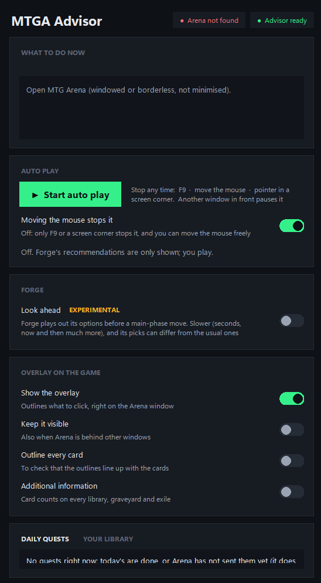
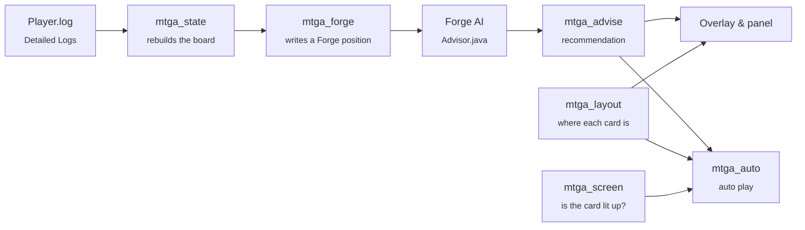

<div align="center">

<picture>
  <source media="(prefers-color-scheme: dark)" srcset="assets/logo-dark.svg">
  
</picture>

### Forge's AI, playing MTG Arena alongside you.

Arena Instinct reads your live MTG Arena game, asks the [Forge](https://github.com/Card-Forge/forge) rules engine what to do,<br>
shows the answer right on the game window, and can play it out for you.


[Features](#-features) · [How it works](#-how-it-works) · [Getting started](#-getting-started) · [Command line](#-command-line) · [Safety](#-built-to-stop-not-to-guess) · [Development](#-development)

</div>

---

<p align="center">
  
</p>

## ✨ Features

| | |
|---|---|
| 🧠 **Real rules engine** | Every decision comes from Forge's AI playing the *actual* position: lands, spells, attacks, blocks, targets, mulligans, scry and more. No hard-coded scripts. |
| 🎯 **On-game overlay** | A click-through overlay outlines exactly what to click on the Arena window. Every click still goes to the game. |
| 🤖 **Full auto play** | Optional. Carries out Forge's recommendation with the mouse, one Arena request at a time, waiting for the game to be ready before every click. |
| 🔭 **Look ahead** <sup>experimental</sup> | Forge simulates its options before a main-phase play, for stronger (but slower) decisions. |
| 📋 **Daily quests** | Reads your quests and ranks your decks by how many games each needs to finish them. |
| 🎲 **Library odds** | Live draw odds for every card left in your library, including the chance of a land in the next draws. |

## 🧩 How it works

Arena Instinct never touches the game's memory or files. It reads what Arena already publishes, and looks at the window like you do.



1. **Read.** `mtga_state.py` rebuilds the live board from Arena's own log (the *Detailed Logs* feed).
2. **Translate.** `mtga_forge.py` turns that board into a Forge game state, card for card.
3. **Decide.** A Forge process stays running in the background (`forge_advisor/Advisor.java`) and answers each question in a fraction of a second.
4. **Locate.** `mtga_layout.py` is a port of Arena's own layout code: it computes where every card sits on screen from the game state alone.
5. **Act.** The overlay draws the answer. With auto play on, `mtga_auto.py` waits until Arena lights the card up as usable (`mtga_screen.py`), checks in the log that the pointer is on the right card, then clicks.

## 🚀 Getting started

### Requirements

- **Windows** 10 or 11
- **MTG Arena** in **windowed** or **borderless** mode (not exclusive fullscreen)
- **Detailed Logs** switched on in Arena: *Options → Account → Detailed Logs (Plugin Support)*
- **Python 3** with Tkinter (included in the python.org installer)
- **Java 17**: [Eclipse Temurin](https://adoptium.net/temurin/releases/?version=17) in its default folder, or set `JAVA_HOME`
- **Forge runtime** in `forge_runtime/` (see [Building the Forge runtime](#building-the-forge-runtime))

### Run it

```powershell
python mtga_gui.py
```

1. Open MTG Arena and start a match.
2. Wait for both pills at the top of the panel to go green: **Arena found** and **Advisor ready**. The first start loads Forge's card database (about 20 s).
3. Follow the recommendation under **What to do now**, or turn on **Show the overlay** to see it on the game.
4. Press **Start auto play** to let it play for you.

> [!TIP]
> Arena is installed somewhere unusual? Set the `MTGA_DIR` environment variable to its folder. Steam libraries, the Wizards installer and the Epic Games store are found automatically.

## 🛡️ Built to stop, not to guess

Auto play is opt-in and off by default, and it's designed to hand control back rather than make a wrong move.

- ⏹️ **Stop instantly:** press **F9**, move the mouse, or throw the pointer into a screen corner.
- ⏸️ **Pauses itself** whenever another window is in front, and carries on when Arena is back.
- ✅ **Acts only on what it fully understands.** Anything else (a planeswalker attack, a double-faced land, an unknown prompt) is left to you, with a note on the overlay.
- 👀 **Waits for the game:** it never clicks a card that's still animating or one Arena hasn't marked as usable.
- ⌨️ **Mouse only:** input goes out through Win32 `SendInput`. Nothing is ever typed into the game.

## 💻 Command line

Every module also runs on its own:

| Command | What it does |
|---|---|
| `python mtga_gui.py` | Control panel (add `--console` to keep the console for errors) |
| `python mtga_overlay.py` | Overlay only. Flags: `--always`, `--cards`, `--extra`, `--auto`, `--simulate`, `--mouse-free` |
| `python mtga_advise.py` | One recommendation for the live position (`--follow` to keep answering, `--simulate` to look ahead) |
| `python mtga_state.py` | Print the live board (`--once`, `--json`, `--coords`) |
| `python mtga_forge.py -o position.pzl` | Export the position as a Forge puzzle file |
| `python mtga_quests.py` | Your daily quests and the best deck for each |
| `python mtga_odds.py --draws 3` | Draw odds for your library |
| `python mtga_account.py` | Decks, inventory, rank, quests and events (`--deck "name"`, `--json`) |
| `python mtga_screen.py` | How lit up every card is right now |

## 🔧 Development

### Project layout

```
mtga_gui.py        control panel
mtga_overlay.py    click-through overlay on the Arena window
mtga_auto.py       full auto play
mtga_mouse.py      where to click, and the clicks themselves
mtga_screen.py     reads the Arena window: which cards are lit up
mtga_advise.py     talks to Forge and turns its answer into a recommendation
mtga_forge.py      Arena board → Forge game state
mtga_state.py      Player.log → live board
mtga_layout.py     screen position of every card (port of Arena's layout code)
mtga_account.py    decks, inventory, rank, quests
mtga_quests.py     which deck finishes your quests soonest
mtga_odds.py       draw odds
forge_advisor/     Advisor.java, the bridge to Forge's AI
forge_runtime/     the packed Forge engine (jar + card data)
data/              layout data dumped from the client, test positions and recorded games
tools/             dump and capture scripts
tests/             regression tests
```

### Building the Forge runtime

`forge_runtime/` holds only the part of Forge the advisor needs (about 64 MB). To rebuild it from source (Java 17 + Maven, ~10 minutes):

```powershell
git clone --depth 1 https://github.com/Card-Forge/forge.git forge
mvn -B -q -pl forge-gui-desktop -am install -DskipTests -Dcheckstyle.skip=true
python tools/build_forge_runtime.py
```

### After an Arena patch

The layout data in `data/` comes from Arena's asset bundles. If outlines stop lining up after a client update, dump it again (needs `UnityPy`):

```powershell
python tools/dump_holders.py
python tools/dump_scaffolds.py
python tools/dump_browsers.py
python tools/dump_camera.py
python tools/overlay_check.py   # draws the computed outlines on a screenshot (needs Pillow)
```

### Tests

```powershell
python -m unittest discover -s tests -v
```

- **Forge positions:** 30+ hand-built positions in `data/tests/*.pzl` (lethal, blocks, removal, mulligans, tutors, the stack…) checked against `expected.json`, with a fixed seed so the answers can be repeated.
- **Log replays:** recorded games run through the parser, the layout port and the exporter, compared request by request. Record a new one with `tools/capture_test_game.py`, then `python tests/test_log_replay.py --update`.

Tests that need Java, Forge or an Arena install are skipped when those aren't present. Set `MTGA_SKIP_FORGE=1` to skip the Forge tests.

## 🙏 Credits

- **[Forge](https://github.com/Card-Forge/forge)**, the open-source MTG rules engine and AI that makes every decision. Forge is licensed under the GNU GPL v3 (see `forge_runtime/LICENSE.txt`).

## ⚠️ Disclaimer

Arena Instinct is an independent fan project. It is **not affiliated with, endorsed by, or sponsored by Wizards of the Coast** or Magic: The Gathering Arena. Magic: The Gathering is a trademark of Wizards of the Coast.

Automating play may violate MTG Arena's Terms of Service and could put your account at risk. **Use it at your own risk.**

<div align="center">
<br>
<sub>Made with 🧡 and too many Plains.</sub>
</div>
